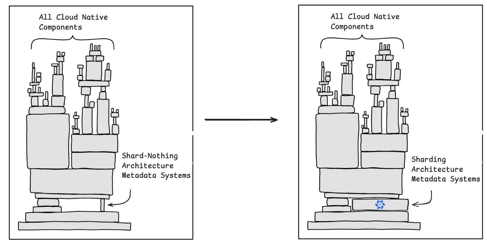

<p align="center">
  
</p>

<h2 align="center">Oxia</h2>

<p align="center">
  A robust, scalable metadata store and coordination system for large-scale distributed systems,
  with built-in support for stream index storage.
</p>

<p align="center">
  <a href="https://oxia-db.github.io/docs/getting-started">Getting Started</a> |
  <a href="https://oxia-db.github.io/docs/what-is-oxia">Documentation</a> |
  <a href="https://oxia-db.github.io/blog">Blog</a>
</p>

<p align="center">
  <a href="https://codecov.io/gh/oxia-db/oxia"></a>
<a href="https://app.fossa.com/projects/git%2Bgithub.com%2Foxia-db%2Foxia?ref=badge_shield" alt="FOSSA Status"></a>
  <a href="https://github.com/oxia-db/oxia/blob/main/LICENSE"></a>
  <a href="https://github.com/oxia-db/oxia/discussions/new/choose"></a>
  <a href="https://slack.cncf.io"></a>
</p>

## Why Oxia



<sub>Original image credited to xkcd.com/2347, alterations by Qiang Zhao.</sub>

Metadata stores such as ZooKeeper and etcd keep the whole dataset in a single replicated group, so their capacity and
throughput are bounded by what one group of nodes can handle. Oxia shards the key space across many replicated groups,
so it scales horizontally with the size of the dataset and the request rate, while keeping the coordination primitives
those systems provide.

Read more in [What is Oxia?](https://oxia-db.github.io/docs/what-is-oxia) and the
[design goals](https://oxia-db.github.io/docs/architecture/design-goals).

## Quick Start

Start a standalone server, listening on `localhost:6648`:

```bash
docker run -p 6648:6648 oxia/oxia:latest oxia standalone
```

Write and read a record with the CLI:

```bash
oxia client put my-key my-value
oxia client get my-key
oxia client get my-key -v   # include version info
```

See [Getting Started](https://oxia-db.github.io/docs/getting-started) for the full guide.

## Features

- [Consistency model](https://oxia-db.github.io/docs/features/consistency-model)
- [Ephemeral records](https://oxia-db.github.io/docs/features/ephemerals)
- [Notifications](https://oxia-db.github.io/docs/features/notifications)
- [Versioning](https://oxia-db.github.io/docs/features/versioning)
- [Sequence keys](https://oxia-db.github.io/docs/features/sequence-keys)
- [Secondary indexes](https://oxia-db.github.io/docs/features/secondary-indexes)
- [Partition keys](https://oxia-db.github.io/docs/features/partition-keys)
- [Namespaces](https://oxia-db.github.io/docs/features/namespaces)
- [Key sorting](https://oxia-db.github.io/docs/features/oxia-key-sorting)

## Client SDKs

[Go](https://oxia-db.github.io/docs/clients/go) ·
[Java](https://oxia-db.github.io/docs/clients/java) ·
[Node.js](https://oxia-db.github.io/docs/clients/node) ·
[Python](https://oxia-db.github.io/docs/clients/python) ·
[Rust](https://oxia-db.github.io/docs/clients/rust)

## Learn More

- **Deployment**: [Helm](https://oxia-db.github.io/docs/deployment/kubernetes/helm),
  [bare metal](https://oxia-db.github.io/docs/deployment/bare-metal),
  [embedding](https://oxia-db.github.io/docs/deployment/embedding),
  [security](https://oxia-db.github.io/docs/deployment/security)
- **Architecture**: [logical](https://oxia-db.github.io/docs/architecture/logical-architecture) and
  [physical](https://oxia-db.github.io/docs/architecture/physical-architecture) architecture,
  [replication protocol](https://oxia-db.github.io/docs/consensus/replication-protocol)
- **Correctness**: [protocol safety](https://oxia-db.github.io/docs/correctness/protocol-safety),
  [TLA+](https://oxia-db.github.io/docs/correctness/tla+),
  [Maelstrom](https://oxia-db.github.io/docs/correctness/maelstrom)
- **Operations**: [admin](https://oxia-db.github.io/docs/admin), [CLI](https://oxia-db.github.io/docs/reference/cli),
  [configuration](https://oxia-db.github.io/docs/reference/config), [metrics](https://oxia-db.github.io/docs/reference/metrics)
- [Benchmarks](https://oxia-db.github.io/docs/benchmarks)
- [Migrating from ZooKeeper / etcd](https://oxia-db.github.io/docs/migration)

## Community

Join the discussion in [#oxia](https://cloud-native.slack.com/archives/C09KFHURYF8) on the CNCF Slack. If you are not a
member yet, get an invite at [slack.cncf.io](https://slack.cncf.io). You can also open an
[issue](https://github.com/oxia-db/oxia/issues/new) or start a
[discussion](https://github.com/oxia-db/oxia/discussions/new/choose).

Oxia follows the [CNCF Code of Conduct](CODE_OF_CONDUCT.md).

- [Contributing](CONTRIBUTING.md): how to build, test, report issues and submit changes
- [Governance](GOVERNANCE.md): how the project is run and how decisions are made
- [Maintainers](MAINTAINERS.md): the current maintainers of the project
- [Security](SECURITY.md): how to report a security vulnerability
- [Adopters](ADOPTERS.md): the organizations and the projects that are using Oxia

## License

Copyright 2023-2026 The Oxia Authors

Licensed under the Apache License, Version 2.0: http://www.apache.org/licenses/LICENSE-2.0
